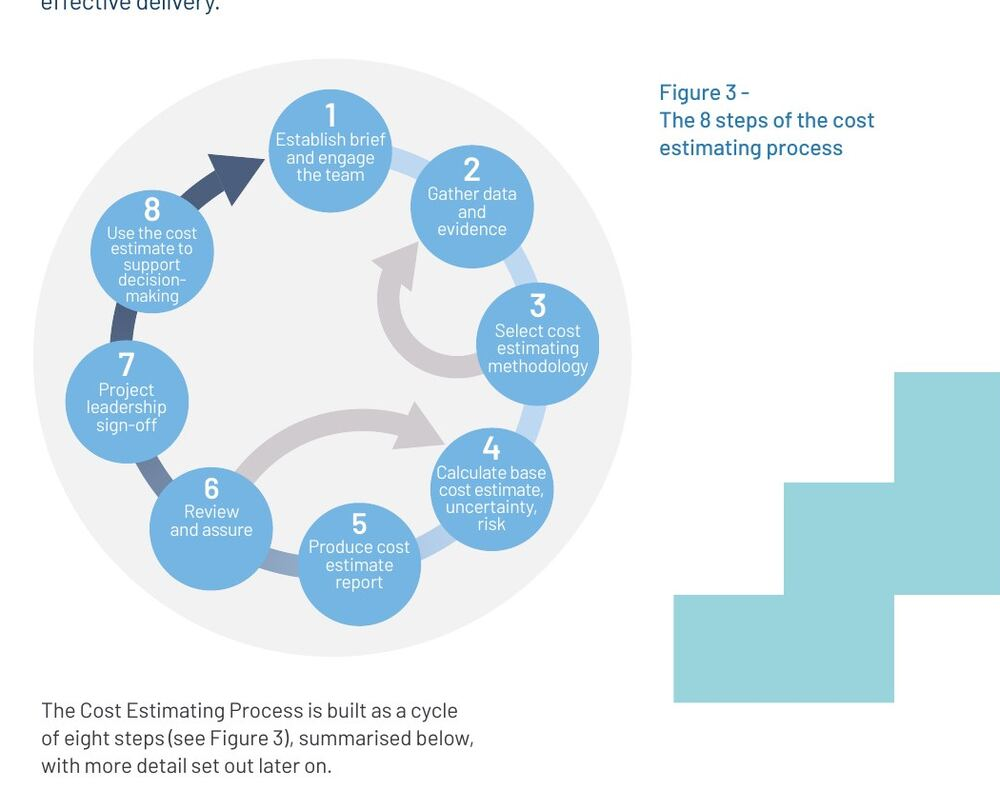

# Estimation Under Uncertainty

## Estimate for a Decision

An estimate is a reasoned statement about an uncertain quantity based on the
information available now. It is useful only when its purpose is explicit.

Different decisions need different estimates:

- comparing several options may need rough relative size;
- checking affordability may need a lifecycle cost range;
- planning a release may need team throughput and dependencies;
- deciding whether to investigate may need only the scale of uncertainty; and
- committing to an external deadline needs much stronger evidence and risk
  analysis than ordering a backlog.

An estimate is not automatically a promise, target, budget, or deadline. When
one number is used for all four, uncertainty becomes hidden and incentives can
distort the analysis.

*The UK Infrastructure and Projects Authority presents estimating as an
evidence-based cycle: establish the brief, gather evidence, choose a method,
account for uncertainty and risk, document, assure, approve, and use the result
for a decision.*

Source: [Infrastructure and Projects Authority, Cost Estimating Guidance, Figure 3](https://www.gov.uk/government/publications/cost-estimating-guidance), available under the [Open Government Licence v3.0](https://www.nationalarchives.gov.uk/doc/open-government-licence/version/3/).

## Define What Is Being Estimated

Before choosing a method, complete this sentence:

> We are estimating **[quantity]** for **[scope]** to support **[decision]**,
> using information available on **[reference date]**.

Common quantities are not interchangeable:

| Quantity | Question | Typical unit |
|---|---|---|
| Effort | How much human work may be required? | Person-days, relative points |
| Duration | How much calendar time may pass? | Days, weeks, date range |
| Cost | What financial resources may be required? | Currency range |
| Complexity | How difficult or interconnected is the work? | Relative category or points |
| Throughput | How much similarly sized work is completed over time? | Items per period |
| Value | What outcome may this create? | Outcome-specific evidence or proxy |

Ten person-days of effort do not imply ten days of duration. Dependencies,
specialist availability, reviews, waiting time, and parallel work change the
calendar result.

## Scope Maturity Determines Precision

Early estimates are based on incomplete scope, weak reference data, and many
unresolved decisions. Precision should increase only as the evidence improves.
A detailed number based on an immature scope is still an immature estimate.

The UK guidance explicitly recommends presenting estimates as ranges that
reflect risk and uncertainty and narrowing those ranges as the project matures.
The principle applies beyond infrastructure even though the detailed guidance
was written for major projects.

## Record the Basis of Estimate

A credible estimate should expose:

- the included and excluded scope;
- the unit and reference date;
- the method used and why it fits;
- source data and comparable work;
- assumptions and dependencies;
- known risks and unknowns;
- optimistic, expected, and pessimistic outcomes where useful;
- confidence and the reason for that confidence; and
- the event that should trigger re-estimation.

The estimate can then be challenged without pretending that disagreement is a
calculation error.

## Common Failure Modes

### Anchoring

The first number mentioned influences later estimates. Ask people to estimate
independently before revealing values, or begin with reference data rather than
a stakeholder target.

### False precision

`17.4 days` appears more informed than `three to five weeks`, even when the
inputs cannot support that precision. Match the number of significant digits
to the quality of the evidence.

### Planning fallacy and optimism bias

Teams imagine the successful path and underweight interruptions, integration,
review, rework, and failure. Use comparable completed work and deliberately
consider downside scenarios.

### Strategic estimates

People may lower an estimate to obtain approval or increase it to create a
safety margin. Separate the analytical estimate from the target, contingency,
and negotiation.

### Treating uncertainty as scope

Adding effort without naming the source of uncertainty makes the estimate hard
to review. Record uncertainty explicitly and decide whether to investigate,
carry contingency, split the work, or accept the risk.

## Check Your Understanding

1. Why can effort and duration differ substantially?
2. What makes a range more useful than a point estimate?
3. When should an estimate be updated?

Show solution

1. Duration includes sequencing, waiting, dependencies, availability, and
   parallel work, while effort measures the human work required.
2. A range communicates plausible variation and invites discussion about its
   causes. It is useful only when its assumptions and confidence are visible.
3. Update it when scope, evidence, assumptions, dependencies, risks, team
   capability, or actual performance changes materially.

## References

- [Infrastructure and Projects Authority: Cost Estimating Guidance](https://www.gov.uk/government/publications/cost-estimating-guidance)
- [U.S. GAO: Cost Estimating and Assessment Guide](https://www.gao.gov/products/gao-20-195g)
- [Government Analysis Function: Communicating Quality, Uncertainty and Change](https://analysisfunction.civilservice.gov.uk/policy-store/communicating-quality-uncertainty-and-change/)
