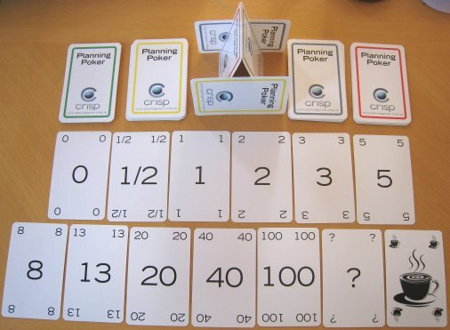
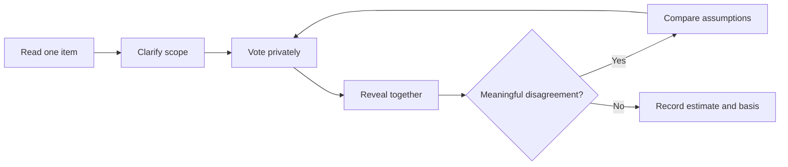

# Collaborative Relative Estimation

## The Conversation Is the Main Output

Collaborative estimation helps the people who may perform the work uncover
different interpretations, hidden acceptance criteria, dependencies, and
technical concerns. The number is a compact record of that conversation, not a
substitute for it.

PMI's Disciplined Agile guidance describes story points as a relative sizing
measure and emphasizes that understanding is more important than apparent
accuracy. Story points are local to a team; they should not be converted into a
universal productivity measure or compared across teams.

## Choose a Relative Scale

Two common scales are:

- **T-shirt sizes:** XS, S, M, L, XL for coarse grouping; and
- **modified Fibonacci points:** 1, 2, 3, 5, 8, 13, 20, 40, 100.

The widening gaps in the Fibonacci-style scale discourage false precision as
work becomes larger and less understood. A value may represent a team's
combined view of effort, complexity, uncertainty, and risk, but the team should
agree what it means before using it.

*Planning Poker cards allow participants to select estimates independently and
reveal them together, reducing the influence of the first visible estimate.*

Source: [Hkniberg, Crisp Planning Poker Deck, Wikimedia Commons](https://commons.wikimedia.org/wiki/File:CrispPlanningPokerDeck.jpg), released into the public domain.

## Planning Poker

Planning Poker works best with a small set of sufficiently understood items and
a multidisciplinary group able to discuss the work.

1. Present one item with its outcome and acceptance criteria.
2. Clarify the scope without designing the entire solution.
3. Each estimator privately selects a value.
4. Reveal all values at the same time.
5. Ask the highest and lowest estimators to explain their assumptions.
6. Record new questions, dependencies, and scope clarifications.
7. Vote again or mark the item for investigation or splitting.
8. Record the estimate and its basis.

Consensus does not require forcing everyone to the same belief. If disagreement
reveals a critical unknown, the correct output may be a question, experiment,
or split item rather than a negotiated average.

## Team or Affinity Estimation

When a backlog contains many items, estimating each one through repeated poker
rounds can be slow. Team Estimation, sometimes called affinity estimation,
places items relative to one another.

1. Choose one understood reference item.
2. Place each new item as smaller, similar, or larger.
3. Allow participants to move items when they disagree.
4. Discuss the movements that reveal different assumptions.
5. Group the resulting columns into T-shirt sizes or point values.
6. Flag outliers and poorly understood items for deeper analysis.

This method is fast and exposes the shape of the whole backlog. Its limitation
is that weak reference items or unspoken assumptions can distort every group.

## Prepare Items Before Estimating

An item should include enough information to support a useful discussion:

- intended outcome or user need;
- scope and acceptance evidence;
- important non-functional requirements;
- known dependencies and constraints;
- explicit exclusions;
- unresolved questions; and
- a comparable reference item when one exists.

Do not estimate a title such as "add AI". Large or unclear items should be
split, investigated, or marked as unknown.

## Strengths and Limitations

| Method | Useful when | Main limitation |
|---|---|---|
| T-shirt sizing | Early, coarse portfolio comparison | Categories can hide large internal variation |
| Planning Poker | A small set needs shared understanding | Slow for large backlogs; consensus can become performative |
| Team Estimation | Many items need rapid relative ordering | Weak references can distort the whole result |
| Reference stories | A stable team has comparable completed work | References become stale when context or team changes |

## Check Your Understanding

1. Why should estimates be revealed simultaneously in Planning Poker?
2. What should a team do when estimates remain far apart?
3. Can one team's five-point item be compared with another team's five points?

Show solution

1. Simultaneous reveal reduces anchoring on the first visible estimate.
2. Record the different assumptions, clarify or split the item, or define an
   investigation. Do not average incompatible understandings.
3. Usually not. Story points are calibrated to a team's own references and way
   of working.

## References

- [PMI Disciplined Agile: Estimation](https://www.pmi.org/disciplined-agile/developer/practice-estimations)
- [PMI Disciplined Agile: Team Estimation](https://www.pmi.org/disciplined-agile/team-estimation)
- [Wikimedia Commons: Crisp Planning Poker Deck](https://commons.wikimedia.org/wiki/File:CrispPlanningPokerDeck.jpg)
