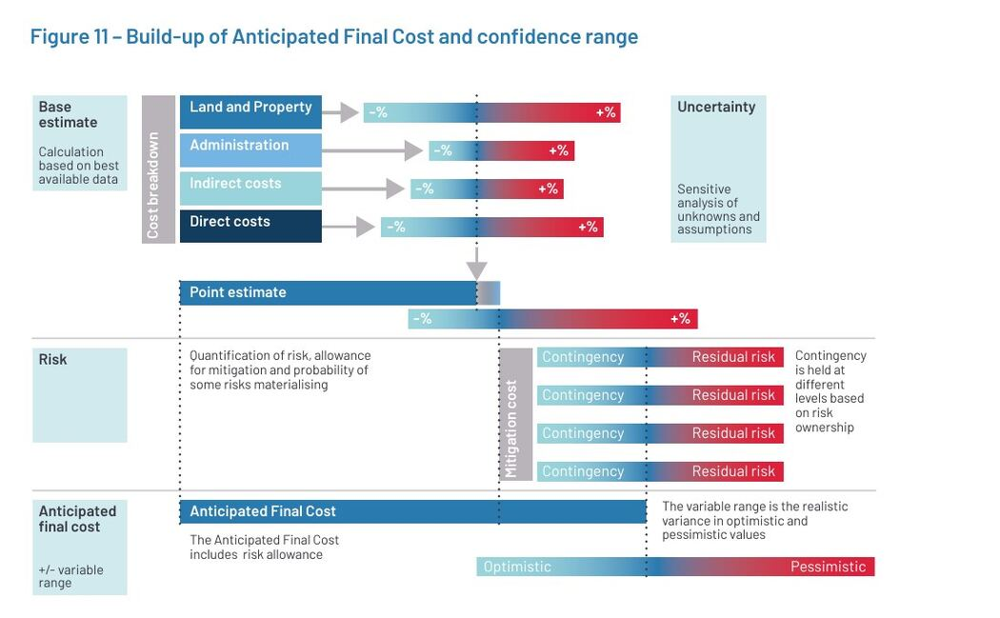

# Range and Reference Estimation

## Use More Than One View of the Future

A single value hides how the result could change. Range methods ask what a
credible upside, central case, and downside look like. Reference methods ask
what happened in comparable completed work. Expert judgement adds contextual
knowledge but should expose its assumptions and possible biases.

These approaches can be combined. For example, experts can select comparable
projects, adjust their observed values, and then define a range around the
result.



*The central estimate, uncertainty, and risk allowance answer different
questions. Combining them visibly preserves the optimistic-to-pessimistic range
instead of hiding it behind one number.*

Source: [Infrastructure and Projects Authority, Cost Estimating Guidance, Figure 11](https://www.gov.uk/government/publications/cost-estimating-guidance), available under the [Open Government Licence v3.0](https://www.nationalarchives.gov.uk/doc/open-government-licence/version/3/).

## Three-Point Estimation

For one clearly defined quantity, collect:

- **O, optimistic:** a credible favorable case, not a miracle;
- **M, most likely:** the most plausible value under current assumptions; and
- **P, pessimistic:** a credible unfavorable case, not every imaginable
  disaster.

Two common summaries are:

```text
Triangular mean = (O + M + P) / 3
PERT-style expected value = (O + 4M + P) / 6
PERT-style standard deviation approximation = (P - O) / 6
```

The formulas do not make weak inputs reliable. The most useful discussion is
often why `P - O` is wide and what evidence could narrow it. The PERT-style
standard deviation is a modelling approximation, not proof that the outcome
follows a normal distribution.

### Example

A team estimates the effort for a migration work package:

| Scenario | Effort | Basis |
|---|---:|---|
| Optimistic | 8 person-days | Clean data and known integration |
| Most likely | 14 person-days | Expected cleanup and one review cycle |
| Pessimistic | 29 person-days | Data defects and external approval delay |

The PERT-style expected value is `(8 + 4 x 14 + 29) / 6 = 15.5` person-days.
Reporting only `15.5` would hide the most important information: data quality
and approval remain major uncertainty drivers.

## Analogous Estimation

Analogous estimation uses one or more comparable completed items or projects.
It is especially useful early, when detailed scope is unavailable but relevant
history exists.

1. Define the quantity and scope being estimated.
2. Identify potential reference cases.
3. Compare scope, scale, technology, team, dependencies, and environment.
4. Exclude misleading comparisons.
5. Adjust the observed result for material differences.
6. Produce a range and record the adjustment logic.


Reference-class evidence can counter the planning fallacy, but a famous project
or superficially similar feature is not automatically a valid comparison.

## Expert Judgement

Experts can identify hidden constraints, failure modes, and realistic
comparisons. Their judgement is still evidence that must be examined, not a
fact that ends discussion.

Use expert judgement well:

- provide a clear brief and the decision the estimate will support;
- ask for assumptions, references, ranges, and confidence;
- collect independent views before group discussion when possible;
- include the people who understand implementation, testing, operations,
  security, data, and domain constraints;
- document disagreements rather than averaging them silently; and
- revisit the estimate when new evidence arrives.

## Select a Method Based on Evidence

| Situation | Useful starting method |
|---|---|
| Many backlog items, stable team | Relative or affinity estimation |
| Small set needing team discussion | Planning Poker |
| One uncertain cost or duration | Three-point estimate |
| Early project with credible history | Analogous estimate |
| Specialist or domain constraint | Independent expert judgement |
| Repeated, similarly sized flow | Historical throughput |

No method removes uncertainty. Select the lightest method that supports the
decision, then improve it when the cost of being wrong justifies more evidence.

## Calibrate with Actual Outcomes

After completion, compare the estimate with the result and ask:

- Was the scope stable and comparable?
- Which assumption was wrong or missing?
- Was the error systematic or exceptional?
- Did the chosen range contain the outcome?
- Should reference items, confidence rules, or decomposition change?

Calibration is for improving the process, not blaming individuals for an
uncertain forecast.

## Check Your Understanding

1. Why should optimistic and pessimistic cases remain credible?
2. What makes a completed project a useful analogue?
3. Does expert agreement prove that an estimate is correct?

<details>
<summary>Show solution</summary>

1. Impossible extremes produce a range that cannot guide a decision. Each case
   should correspond to an explainable scenario.
2. Its scope, scale, team, technology, dependencies, and environment are similar
   enough that observed results can be adjusted transparently.
3. No. Experts may share the same assumptions or bias. Agreement can increase
   confidence only when the reasoning and evidence are strong.

</details>

## References

- [Infrastructure and Projects Authority: Cost Estimating Guidance](https://www.gov.uk/government/publications/cost-estimating-guidance)
- [U.S. GAO: Cost Estimating and Assessment Guide](https://www.gao.gov/products/gao-20-195g)
- [PMI Disciplined Agile: How to Use Estimates](https://www.pmi.org/disciplined-agile/da-flex-toc/how-to-use-estimates)
