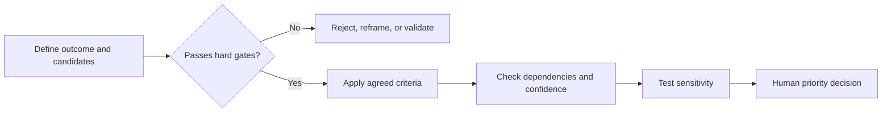
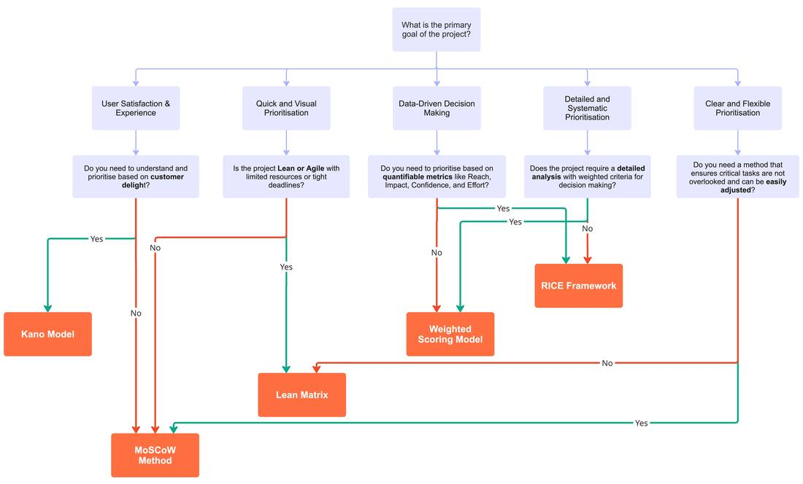

# Prioritization as a Decision

## Ranking Is Not the Starting Point

Prioritization allocates scarce attention, capacity, and money among competing
options. A ranking is meaningful only when the intended outcome, constraints,
evidence, and decision rights are visible.

Before scoring anything, define:

- the outcome and strategic objective;
- the options being compared at a similar level of detail;
- the decision horizon and available capacity;
- required evidence and confidence;
- legal, safety, security, or operational hard gates;
- dependencies and enabling work;
- the person or group with final decision authority; and
- the event that should trigger reprioritization.

## Separate Gates from Trade-Offs

A high score cannot compensate for work that is unlawful, unsafe, technically
impossible, or incompatible with a committed dependency. Apply hard gates
before comparing trade-offs.

Dependencies do not automatically make an item valuable. They explain which
valuable outcomes require enabling work and which sequence is feasible.

## Define Criteria Before Seeing Scores

Useful criteria are tied to the decision rather than copied from a generic
framework. Examples include:

- expected user or business outcome;
- strategic alignment;
- number of people affected;
- urgency or cost of delay;
- confidence in the evidence;
- total lifecycle effort and cost;
- risk reduction or learning value;
- operational and sustainability impact; and
- dependency enablement.

For every criterion, define the unit or rating scale and what the endpoints
mean. A scale from one to five is not objective merely because it uses numbers.

## Value and Effort Need Evidence

An impact-effort matrix is useful for a fast conversation, especially when
evidence is limited. It is dangerous when teams label desired ideas as high
impact and inconvenient work as high effort without defining either axis.

*The decision question should guide the choice of method. Use this guide to
start a discussion, then verify that the proposed framework fits the available
evidence, constraints, and decision.*

## Prioritize Outcomes, Not Only Features

A backlog can contain several kinds of work:

- user-facing outcomes and features;
- enabling architecture or data work;
- defects and reliability improvements;
- security, privacy, accessibility, and legal requirements;
- experiments that reduce uncertainty;
- operations, monitoring, and support; and
- retirement or migration work.

Comparing all of them with one simplistic value score can hide mandatory or
enabling work. Use categories, gates, dependencies, or reserved capacity when
their decision logic differs.

## Check Sensitivity Before Deciding

A useful prioritization model should show when the decision is fragile.

Test questions include:

- Does a small change in one weight reverse the ranking?
- What happens if a low-confidence impact estimate is halved?
- Is one criterion counted twice under different names?
- Does the result change when lifecycle effort replaces build effort?
- Are mandatory or enabling items being penalized for indirect value?
- Would another stakeholder define the criteria differently?

When a ranking changes easily, the next action may be to gather evidence rather
than declare a winner.

## Governance and Reprioritization

Record the decision, not only the final order:

- criteria, scales, and weights;
- evidence and assumptions for each rating;
- gates and dependencies;
- confidence and sensitivity findings;
- overrides and their rationale;
- rejected or deferred options; and
- review trigger or expiry date.

Transparent overrides are healthier than manipulating weights until the model
produces a preferred answer.

## Check Your Understanding

1. Why should hard gates be applied before scoring?
2. What does a sensitivity test reveal?
3. Why might operational or enabling work need different treatment?

Show solution

1. Some conditions cannot be traded against value or convenience. An unlawful
   or unsafe option should not win through a high average score.
2. It shows whether the ranking is stable or depends on weak assumptions,
   arbitrary weights, or low-confidence inputs.
3. Its value may be indirect, mandatory, or shared across many outcomes, so a
   feature-level score can systematically undervalue it.

## References

- [Nielsen Norman Group: Prioritization Methods in UX Roadmapping](https://www.nngroup.com/articles/prioritization-methods/)
- [Intercom: RICE Prioritization Framework](https://www.intercom.com/blog/rice-simple-prioritization-for-product-managers/)
