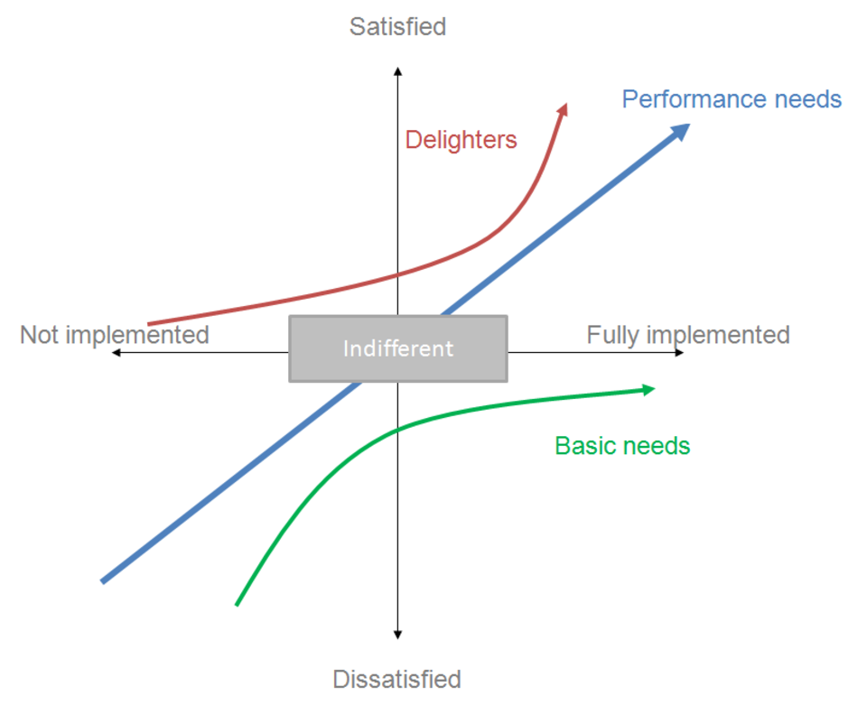
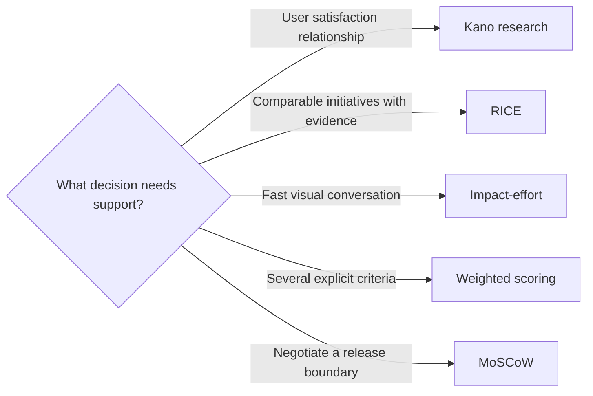

# Prioritization Frameworks

## Choose a Framework for the Question

Frameworks structure a conversation. They do not remove judgement, generate
missing evidence, or determine strategy. Select one based on the decision you
need to make.

| Framework | Main question | Best fit | Main risk |
|---|---|---|---|
| Kano | How does capability affect user satisfaction? | Research-backed product needs | Categories guessed without user evidence |
| RICE | Which initiatives combine reach, impact, confidence, and effort? | Comparable product initiatives | Multiplication creates false precision |
| Impact-effort | Which options appear valuable relative to their size? | Fast visual comparison | Axes remain subjective and coarse |
| Weighted scoring | Which option performs across agreed criteria? | Multi-criteria governance | Weights and overlapping criteria manipulate results |
| MoSCoW | What is essential within a defined delivery boundary? | Scope negotiation | Everything becomes a Must |

## Kano Model

Kano analysis explores how the presence or absence of a capability affects user
satisfaction. Common categories include:

- **Must-be:** expected basics; absence creates dissatisfaction;
- **Performance:** more or better tends to increase satisfaction;
- **Attractive:** unexpected benefits that may delight;
- **Indifferent:** little effect on satisfaction; and
- **Reverse:** some users prefer the capability not to be present.



*Kano categories describe different relationships between functionality and
satisfaction. They should be derived from user research rather than assigned by
the product team alone.*

Source: [Craigwbrown, Kano Model, Wikimedia Commons](https://commons.wikimedia.org/wiki/File:Kano_Model.png), licensed under [CC BY-SA 3.0](https://creativecommons.org/licenses/by-sa/3.0/).

Kano is not simply a ranking of Must-be before Attractive. Basic expectations
may be mandatory, while performance and attractive attributes still require a
business decision about value, cost, and strategy. Categories can also change
as expectations evolve.

## RICE

RICE compares initiatives using:

```text
RICE score = Reach x Impact x Confidence / Effort
```

- **Reach:** how many relevant users or events are affected in a defined period;
- **Impact:** the expected change per reached unit on an agreed scale;
- **Confidence:** how strongly evidence supports the reach and impact inputs;
- **Effort:** total work required over the same scope boundary.

RICE is useful when candidates are comparable and the team can define each
input consistently. Keep the raw inputs and sources visible. A low-confidence
high-impact idea should not look equivalent to a well-supported moderate-impact
idea merely because the products of their values match.

## Impact-Effort Matrix

Plot each candidate using agreed definitions of impact and effort. The four
quadrants are commonly interpreted as:

| Quadrant | Typical response |
|---|---|
| High impact, low effort | Strong candidate, after checking evidence and gates |
| High impact, high effort | Strategic investment or decomposition candidate |
| Low impact, low effort | Optional, opportunistic, or useful filler work |
| Low impact, high effort | Defer, reject, or reframe |

The matrix is a discussion aid, not an automatic queue. Dependencies, mandatory
work, confidence, and lifecycle cost may change the decision.

## Weighted Scoring

Weighted scoring compares candidates across criteria selected for a particular
decision.

```text
Total score = sum of each rating x its criterion weight
```

Use it carefully:

1. Define criteria and scales before rating candidates.
2. Make weights sum to 100% or 1.0.
3. Describe what each rating level means.
4. Link ratings to evidence or assumptions.
5. Check for duplicated criteria.
6. Test alternative weights and uncertain ratings.
7. record any human override explicitly.

Weighted scoring is transparent only when the model is inspectable. A total
without its inputs and rationale is not evidence.

## MoSCoW

MoSCoW classifies scope relative to a defined delivery boundary:

- **Must have:** without it, the bounded solution or release is not viable;
- **Should have:** important, but a documented workaround exists;
- **Could have:** worthwhile if capacity remains;
- **Won't have this time:** explicitly excluded from this boundary.

The final category means "not in this scope," not "never." Define a test for a
Must, such as legal necessity, safety, or failure of the agreed outcome. If
almost everything is a Must, the boundary or stakeholder negotiation is not
finished.

## A Practical Selection Guide



Combining methods can be useful when each adds a distinct view. For example,
Kano can provide user evidence, RICE can compare initiatives, and MoSCoW can
define the boundary of the selected release. Combining formulas that count the
same concept repeatedly creates noise rather than rigor.

## Check Your Understanding

1. Why is Kano classification not valid without user evidence?
2. What role does confidence play in RICE?
3. How can a team test whether a weighted score is robust?

<details>
<summary>Show solution</summary>

1. Kano describes user satisfaction responses. Internal preference cannot
   establish how users react to the presence or absence of a capability.
2. It reduces the score of reach and impact claims that have weak evidence.
3. Change important weights or uncertain ratings within credible ranges and see
   whether the ranking changes.

</details>

## References

- [Intercom: RICE Prioritization Framework](https://www.intercom.com/blog/rice-simple-prioritization-for-product-managers/)
- [Nielsen Norman Group: Prioritization Methods in UX Roadmapping](https://www.nngroup.com/articles/prioritization-methods/)
- [Wikimedia Commons: Kano Model Diagram](https://commons.wikimedia.org/wiki/File:Kano_Model.png)
- [ProductPlan: MoSCoW Prioritization](https://www.productplan.com/glossary/moscow-prioritization/)
