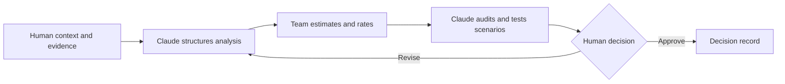

# Claude Code as Decision Support

## Delegate Structure, Not Accountability

Claude Code can read the course, interview the group, create tables, calculate
approved formulas, check consistency, and challenge weak assumptions. It does
not know the team's real capability, internal constraints, user value, or
delivery history unless people provide reliable evidence.

Use Claude for four kinds of work:

1. **Structure:** create backlog, estimation, scoring, and decision files.
2. **Clarification:** identify ambiguous scope, missing criteria, and unknowns.
3. **Calculation:** apply an approved formula and compare scenarios.
4. **Challenge:** find unsupported ratings, fragile rankings, and inconsistent
   scope.

The people who understand the work estimate it. The people accountable for the
outcome approve the priority decision.

## Establish an Evidence Boundary

Tell Claude to label each important input as:

- verified internal evidence;
- externally sourced evidence;
- historical reference;
- team estimate;
- assumption;
- constraint;
- unresolved question; or
- AI suggestion.

Claude must not turn an assumption into a fact because it appears plausible. It
must not simulate user research, team estimates, stakeholder approval, or
historical delivery data.

## Use Approval Gates

Require explicit group approval before Claude:

- changes the scope of a backlog item;
- selects the estimation or prioritization method;
- assigns an effort, impact, confidence, or value rating;
- sets criteria or weights;
- removes a hard gate or dependency;
- converts an assumption into evidence; or
- writes the final recommendation.

Claude can propose alternatives, but it should not silently decide.

## Example Starting Prompt

> Read the lesson files and templates. Interview us about our chosen product or
> project backlog. Do not estimate or prioritize the items for us. First check
> that every item has a clear outcome, scope, completion evidence, dependencies,
> and unknowns. Propose an estimation method and a prioritization method with
> reasons, then wait for our approval before creating project files. Label all
> supplied values as evidence, estimates, assumptions, constraints, or unknowns.

This prompt defines the objective, boundaries, human decisions, and stopping
point.

## Ask Claude to Challenge the Result

After the group supplies estimates and ratings, ask Claude to report findings
without editing files:

- Which items use inconsistent scope boundaries?
- Which estimates lack a reference or basis?
- Which disagreements reveal unresolved questions?
- Which criteria overlap or double-count value?
- Which rating has the weakest evidence?
- Which dependencies or hard gates contradict the ranking?
- Which credible input change reverses the top priorities?
- Where does the language imply more certainty than the evidence supports?

The group accepts, corrects, or rejects each material finding and records why.

## AI-Specific Failure Modes

### Invented precision

Claude can produce plausible points, person-days, or impact scores from a short
description. Plausibility is not calibration. Require team input or a documented
reference.

### Circular evidence

An AI-generated market claim repeated by another AI agent is still one
unsupported claim. Verify external sources and keep internal facts human-owned.

### Formula obedience

Claude can calculate a score perfectly while the criteria, units, or scope are
wrong. Audit inputs before trusting arithmetic.

### Preference laundering

A prompt can encode the preferred winner and ask Claude to justify it. Ask for
the strongest counterargument and sensitivity test before the final decision.

## Keep a Collaboration Log

Record important interventions rather than the full chat transcript:

| Claude contribution | Group response | Evidence or reason |
|---|---|---|
| Suggested an estimate | Rejected | No team or historical basis |
| Found overlapping criteria | Accepted | Value was counted twice |
| Proposed a dependency override | Corrected | Dependency enables two outcomes |

The log demonstrates active AI Project Management: delegation, verification,
and accountable decision-making.

## Check Your Understanding

1. Which parts of estimation can Claude perform safely?
2. Why should Claude not assign story points from item descriptions?
3. What is the purpose of a sensitivity test?

Show solution

1. It can structure information, apply approved calculations, compare scenarios,
   and challenge consistency when humans supply the evidence and judgement.
2. Story points depend on the team's references, capability, scope understanding,
   and way of working, which a generic model does not know.
3. It tests whether the priority decision remains stable when uncertain inputs
   or weights change within credible ranges.

## References

- [Claude Code Docs: Common Workflows](https://code.claude.com/docs/en/common-workflows)
- [PMI Disciplined Agile: Estimation](https://www.pmi.org/disciplined-agile/developer/practice-estimations)
