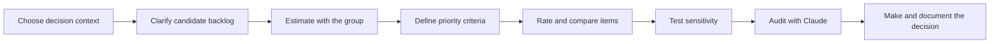

# Session Handout: Estimate and Prioritize a Backlog

## Your Assignment

Choose an existing or plausible AI, data, software, or internal-service backlog.
Your group must:

1. clarify the candidate work;
2. estimate its relative effort or uncertainty;
3. prioritize it using explicit criteria and evidence; and
4. recommend what should start, be investigated, be deferred, or be rejected.

**You are not expected to build the product or complete the backlog.** You are
producing an auditable estimation and priority decision, not an application,
detailed schedule, sprint commitment, or promise of delivery dates.

Claude Code should create most of the files, calculations, and review findings.
The group acts as the AI Project Manager: it supplies context, performs the
estimation discussion, approves criteria and ratings, verifies evidence, and
makes the final decision.

## What You Must Deliver

Your completed repository must contain these seven files:

| File | What it answers | Minimum expected content |
|---|---|---|
| `backlog.md` | What work are we comparing? | Decision context and 8-12 clear candidate items with outcomes, scope, completion evidence, dependencies, gates, and unknowns |
| `estimation-method.md` | How will we estimate this backlog? | Selected method, scale, reference items, participants, assumptions, and reasons for the choice |
| `estimation-results.md` | What did the group estimate and learn? | Results, basis, disagreements, unknowns, confidence, and revision triggers for every item |
| `prioritization-criteria.md` | What does priority mean for this decision? | Outcome, decision boundary, hard gates, criteria, scales, evidence rules, and weights when used |
| `prioritization-results.md` | Which items rank highly, and how stable is that result? | Ratings, evidence, result, dependencies, confidence, and at least one sensitivity test |
| `decision-memo.md` | What should happen next? | Recommended priorities, estimate implications, deferred items, assumptions, confidence, next action, and review trigger |
| `ai-collaboration-log.md` | How did the group supervise Claude? | Important Claude contributions that were accepted, corrected, or rejected, with reasons |

You may create additional visual boards or calculations, but they do not replace
the seven required files.

## What a Successful Result Looks Like

Imagine a group reviewing ten possible improvements to an internal support
service. This is only an illustration; choose your own challenge.

1. The group rewrites vague items such as "add AI" into bounded outcomes with
   completion evidence.
2. It chooses Planning Poker because several team perspectives are needed and
   the backlog is small enough to discuss item by item.
3. Wide estimates reveal that two items depend on an unknown data migration, so
   the group records a validation task instead of inventing precise points.
4. It defines priority as improving resolution quality and reducing repeated
   requests, subject to privacy and operational hard gates.
5. It uses RICE for comparable user-facing items and treats mandatory privacy
   work separately instead of forcing it into the same score.
6. A sensitivity test shows that the leading item changes when its weak impact
   assumption is reduced.
7. The group recommends one evidence-gathering action, two delivery candidates,
   and several deferrals with a clear rationale.

The result is not "the highest score wins." It is a transparent decision that
shows what is known, what is estimated, what remains uncertain, and what should
happen next.

*Clarify and estimate the work before using effort in a prioritization model.
Define the criteria before calculating a ranking, then challenge the result
before making the decision.*

## Ground Rules

- Each group should choose a different backlog or product context.
- The backlog must be discussable without confidential, personal, or
  commercially sensitive information.
- Claude creates and edits files; the group approves material decisions.
- Claude must not assign the final estimates, ratings, criteria, weights, or
  priorities on the group's behalf.
- Every important value must link to evidence or be labelled as an estimate,
  assumption, constraint, or unknown.
- Story points are local relative sizes, not hours and not a measure for
  comparing teams.
- A prioritization score supports a decision; it does not make the decision.
- Hard gates and dependencies must remain visible even when they do not improve
  a score.
- Claude must show proposed changes before applying a major scope or decision
  revision.

## Step 1: Choose the Decision Context

Choose a real or plausible product, project, or service with 8-12 competing
candidate items. You may use work from an earlier course project, but the items
must be understandable without relying on hidden context.

Good candidates include:

- product improvements competing for limited capacity;
- work packages from an approved project direction;
- experiments competing for research or validation capacity;
- technical, operational, compliance, and user-facing improvements; or
- internal-service changes with different value, effort, and risk profiles.

Avoid a list where the order is already fixed, every item is mandatory, or the
items have no shared decision boundary.

Open the project with Claude Code using any available interface, such as the VS
Code extension, CLI, desktop application, or another graphical interface.

Ask Claude to read all lesson files and interview the group about:

- the intended user or business outcome;
- who is affected by the decision;
- the candidate work and available capacity;
- the decision horizon;
- known legal, safety, security, or operational gates;
- who understands the work well enough to estimate it; and
- who owns the final priority decision.

Tell Claude not to create estimates or priorities yet.

**The step is complete when:** the group can state one clear decision question,
such as "Which improvements should we investigate or start next within this
capacity and scope?"

## Step 2: Build a Comparable Backlog

Copy [the backlog template](templates/backlog.md) into the project root as
`backlog.md`. Ask Claude to structure 8-12 candidate items from the group's
input.

For each item, review:

- intended outcome or user need;
- included and excluded scope;
- observable completion evidence;
- dependencies and enabling work;
- constraints or hard gates; and
- unresolved questions.

The items should be comparable in scale. Split an item that contains several
independent outcomes. Combine tiny implementation tasks that do not represent a
meaningful decision. If an item is too unclear to estimate, label it for
investigation rather than asking Claude to fill the gaps.

**The step is complete when:** another group can understand every item, tell
when it would be complete, and identify its major unknowns without asking what
the title means.

## Step 3: Select the Estimation Method

Ask Claude to compare the estimation methods from modules 02 and 03 against the
decision context. The group chooses one core method:

- Planning Poker for focused team discussion;
- Team or affinity estimation for rapid relative sizing;
- T-shirt sizing for coarse early comparison;
- three-point estimation for explicit scenario ranges;
- analogous estimation when credible historical references exist; or
- a justified combination when each method adds a distinct view.

Copy [the estimation method template](templates/estimation-method.md) into the
project root as `estimation-method.md` and record:

- the quantity being estimated;
- why the estimate is needed;
- the selected method and scale;
- who participates and why;
- reference items or historical data;
- assumptions and limitations; and
- the conditions that should trigger re-estimation.

Do not convert story points directly into hours. Do not ask Claude to invent a
team velocity or comparable historical project.

**The step is complete when:** the group can explain why this method and unit
fit the decision better than the alternatives.

## Step 4: Estimate the Backlog

Copy [the estimation record template](templates/estimation-record.md) into the
project root as `estimation-results.md`. Run the selected method with the people
in the group.

Claude may facilitate by presenting one item, recording questions, and updating
the file after each approved result. The humans reveal and discuss their own
estimates.

For each item, record:

- estimate, category, or range;
- basis or reference;
- important assumptions;
- disagreement and what caused it;
- unresolved questions;
- confidence; and
- the event that would require a new estimate.

When estimates differ widely, compare assumptions. Clarify or split the item,
or define an investigation. Do not silently average incompatible views.

**The step is complete when:** all candidate items have either a supported
estimate or an explicit reason why they cannot yet be estimated credibly.

## Step 5: Define What Priority Means

Before rating items, define the priority decision. Copy
[the prioritization criteria template](templates/prioritization-criteria.md)
into the project root as `prioritization-criteria.md` and record:

- the intended outcome and decision boundary;
- the available capacity or constraint;
- hard gates applied before scoring;
- dependencies that affect feasible order;
- selected prioritization method;
- criteria and definitions;
- rating scales or units;
- weights, if the method uses them;
- evidence required for each rating; and
- final decision owner.

Ask Claude to identify overlapping criteria and ambiguous scales. The group
must approve the final criteria before seeing a calculated ranking.

For example, do not use both "customer value" and "user impact" unless the
group can explain how they differ. Define what a rating of one and five mean.

**The step is complete when:** two people using the written definitions would
interpret each criterion and scale in approximately the same way.

## Step 6: Apply a Prioritization Method

Choose the method that fits the decision:

- Kano when user research supports satisfaction categories;
- RICE for comparable product initiatives with credible reach and impact data;
- impact-effort for a fast, coarse comparison;
- weighted scoring when several explicit criteria matter; or
- MoSCoW when negotiating scope within a defined delivery boundary.

You may combine methods only when they answer different questions. Do not add
formulas merely to make the analysis look more rigorous.

Copy [the prioritization results template](templates/prioritization-results.md)
into the project root as `prioritization-results.md`. Have the group supply or
approve every rating. Claude may calculate the approved formula and sort the
results.

For each item, keep visible:

- evidence and assumptions behind ratings;
- confidence;
- hard gates and dependencies;
- estimate from the previous step; and
- calculated or categorical result.

**The step is complete when:** every result can be traced back to a defined
criterion and a human-approved input.

## Step 7: Test Whether the Ranking Is Fragile

Ask Claude to identify the weakest high-impact assumption, rating, or weight.
Choose at least one credible change, such as:

- halve a low-confidence impact estimate;
- increase a wide effort estimate to its pessimistic value;
- reduce the weight of one disputed criterion;
- reveal that a dependency is unavailable; or
- apply a legal, privacy, safety, or operational gate.

Recalculate or re-evaluate the priorities and record:

- what changed;
- why the change is credible;
- which rankings moved;
- whether the recommendation still holds; and
- what evidence would make the decision more stable.

**The step is complete when:** the group knows whether its leading priorities
are robust or depend on weak assumptions.

## Step 8: Challenge the Analysis with Claude

Ask Claude to audit the complete analysis and report findings without editing
the files. It should check:

- inconsistent scope boundaries;
- estimates without a basis;
- false precision;
- unsupported value or impact claims;
- duplicated criteria;
- hard gates or dependencies ignored by the ranking;
- mandatory or enabling work unfairly penalized;
- contradictions between confidence and recommendation; and
- language that presents estimates as commitments.

For each material finding, the group must:

- accept it as supported;
- correct the underlying analysis;
- turn it into an assumption or open question; or
- reject it and record the reason.

Copy [the AI collaboration log template](templates/ai-collaboration-log.md)
into the project root as `ai-collaboration-log.md`:

| Claude contribution | Accepted, corrected, or rejected? | Evidence or reason |
|---|---|---|
|  |  |  |

**The step is complete when:** the group has recorded at least one meaningful
Claude contribution that it corrected or rejected, rather than treating all AI
output as authoritative.

## Step 9: Make and Explain the Decision

Copy [the decision memo template](templates/decision-memo.md) into the project
root as `decision-memo.md`. The group makes the final decision.

The memo must state:

- which items should start or move forward;
- which item needs investigation before it can be estimated or prioritized;
- which items are deferred, reframed, or rejected;
- the estimate and capacity implications;
- strongest evidence;
- hard gates and dependencies;
- important assumptions and unknowns;
- sensitivity result and confidence;
- next action; and
- trigger for reviewing the decision.

An item may override the calculated ranking when the reason is explicit. Do not
change the criteria or weights after seeing the result merely to hide the
override.

**The step is complete when:** someone who did not join the exercise can
understand what should happen next, why, how uncertain the recommendation is,
and what new evidence could change it.

## Final Submission Checklist

- [ ] Our backlog contains 8-12 clear and comparable candidate items.
- [ ] Every item has an outcome, scope, completion evidence, dependencies,
      gates, and unknowns where relevant.
- [ ] We selected and justified an estimation method and unit.
- [ ] The people in the group produced the estimates; Claude did not invent
      them.
- [ ] Every estimate has a basis or an explicit reason it remains unknown.
- [ ] We defined the outcome, gates, criteria, scales, and decision owner before
      calculating priorities.
- [ ] Every rating links to evidence or an explicit assumption.
- [ ] We kept dependencies and mandatory work visible.
- [ ] We completed at least one credible sensitivity test.
- [ ] Our decision memo explains priorities, deferrals, uncertainty, and the
      next action.
- [ ] We recorded at least one important Claude contribution that we corrected
      or rejected.
- [ ] We did not include sensitive information.
- [ ] All seven required files are present and consistent.

## Optional Extensions

Start optional work only after all seven required files pass the final
checklist. Choose an extension that improves the decision rather than adding
decorative detail.

### Compare Two Estimation Methods

Apply a second method to the same items. Compare the results and identify which
assumptions, interactions, or reference cases caused meaningful differences.
Recommend which method the team should reuse and under what conditions.

### Compare Two Prioritization Frameworks

Apply a second framework that answers a distinct but relevant question. For
example, compare an impact-effort view with weighted scoring. Explain why the
rankings differ and which result better fits the decision.

### Build a Stronger Sensitivity Analysis

Vary several uncertain inputs across credible ranges. Identify items that stay
near the top, items that move frequently, and the one piece of evidence with
the greatest decision value.

### Add Cost of Delay

Define what is lost when an item is delayed. Consider expiring opportunities,
ongoing operational cost, risk exposure, contractual commitments, and user
harm. Keep cost of delay separate from delivery effort.

### Create a Dependency-Aware Roadmap

Use the approved priorities and dependencies to create a Now-Next-Later or
outcome-based roadmap. Do not present uncertain work as fixed delivery dates.
Show assumptions and review triggers.

### Calibrate Against Historical Work

Find completed comparable items with trustworthy actual data. Compare them with
the current estimates, adjust reference items or confidence, and document why
the calibration is relevant.

### Convert Approved Items into GitHub Issues

Ask Claude to propose GitHub issues for selected items. Each issue should
include the outcome, scope, completion evidence, estimate basis, dependencies,
unknowns, and link to the decision record. Review all proposed issues before
allowing Claude to create them.

### Reprioritize After New Evidence

Introduce one meaningful change, such as lower capacity, a failed assumption,
new user evidence, a security gate, or a changed strategic objective. Ask
Claude to identify which estimates, ratings, and decisions are affected. Approve
only traceable changes.

## Reflection

- Which disagreement improved the shared understanding of the work?
- Which estimate appeared precise without having a strong basis?
- Which criterion had the weakest evidence?
- Did the selected framework reveal or hide mandatory and enabling work?
- Which new evidence would be most likely to change the recommendation?
- Where did Claude add confidence that the group had not earned?
