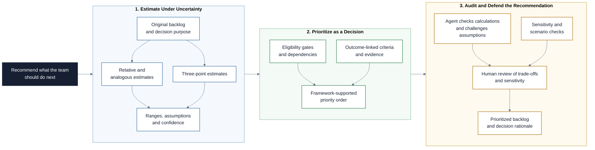

# Estimation and Prioritization

This Markdown-based learning path covers how project and product teams estimate
uncertain work, compare competing opportunities, and make transparent priority
decisions. Participants use collaborative, range-based, reference-based, and
scoring methods while treating estimates and rankings as decision support
rather than objective truth. Claude Code helps structure and challenge the
analysis, while the people responsible for the work and outcomes retain
decision ownership.

## Project at a Glance

The project creates transparent estimates, uses them as one input to
prioritization, and ends with a recommendation that makes uncertainty visible.

## Learning Objectives

By the end of this repository, you should be able to:

- Distinguish effort, duration, cost, complexity, uncertainty, and confidence.
- Explain why an estimate is a current forecast rather than a commitment.
- Select an estimation method appropriate to the available evidence and
  decision.
- Facilitate Planning Poker, affinity estimation, and three-point estimation.
- Improve estimates with reference cases, expert judgement, ranges, and
  calibration.
- Define prioritization criteria before scoring candidate work.
- Apply Kano, RICE, impact-effort, weighted scoring, and MoSCoW appropriately.
- Account for hard gates, dependencies, confidence, and strategic constraints.
- Test whether a priority decision is sensitive to weak assumptions.
- Use Claude Code to structure and critique analysis without inventing evidence
  or replacing team judgement.

## Learning Path

The modules build on each other in order.

| File / Folder | Description |
|---|---|
| [**01 - Estimation Under Uncertainty**](01-estimation-under-uncertainty.md) | Define the object, purpose, evidence, uncertainty, and confidence of an estimate before choosing a technique. |
| [**02 - Collaborative Relative Estimation**](02-collaborative-relative-estimation.md) | Use Planning Poker, affinity estimation, story points, and T-shirt sizes to build shared understanding. |
| [**03 - Range and Reference Estimation**](03-range-and-reference-estimation.md) | Apply three-point, analogous, and expert estimation while documenting assumptions and confidence. |
| [**04 - Prioritization as a Decision**](04-prioritization-as-a-decision.md) | Frame the outcome, gates, criteria, evidence, dependencies, and decision rights before ranking work. |
| [**05 - Prioritization Frameworks**](05-prioritization-frameworks.md) | Compare Kano, RICE, impact-effort, weighted scoring, and MoSCoW without confusing a score with a decision. |
| [**06 - Claude Code as Decision Support**](06-claude-code-as-decision-support.md) | Delegate structure, calculations, research, and challenge while keeping estimates and priorities human-owned. |
| [**07 - Session Handout**](07-session-handout.md) | Estimate and prioritize an original backlog, audit the reasoning, and recommend what should happen next. |

### Additional Folders and Files

| File / Folder | Description |
|---|---|
| [**assets**](assets/) | Local, attributed figures from government guidance and Wikimedia Commons. |
| [**templates**](templates/) | Starting structures for the backlog, estimation record, prioritization analysis, and decision memo. |

## Getting Started

No Python environment is required for this repository.

1. Create a repository from this template and add collaborators when working
   in a group.
2. Clone the repository and open it locally.
3. Read the lesson files in numerical order.
4. Use Claude Code through any available interface and make the project files
   available to it when the handout introduces the analysis workflow.
5. Use the handout and templates to produce the project artifacts.

## AI Collaboration Guidelines

Claude can structure a backlog, expose missing information, calculate an
approved formula, compare scenarios, and challenge inconsistent reasoning. It
cannot know how much work an unfamiliar team will need, validate user value,
or make the final priority decision. Do not enter sensitive data. Record
sources and assumptions, and keep a short log of accepted, corrected, and
rejected AI contributions.

## References & Further Reading

- [UK Infrastructure and Projects Authority: Cost Estimating Guidance](https://www.gov.uk/government/publications/cost-estimating-guidance)
- [U.S. GAO: Cost Estimating and Assessment Guide](https://www.gao.gov/products/gao-20-195g)
- [PMI Disciplined Agile: Estimation](https://www.pmi.org/disciplined-agile/developer/practice-estimations)
- [PMI Disciplined Agile: Team Estimation](https://www.pmi.org/disciplined-agile/team-estimation)
- [Intercom: RICE Prioritization Framework](https://www.intercom.com/blog/rice-simple-prioritization-for-product-managers/)
- [Nielsen Norman Group: Prioritization Methods in UX Roadmapping](https://www.nngroup.com/articles/prioritization-methods/)
